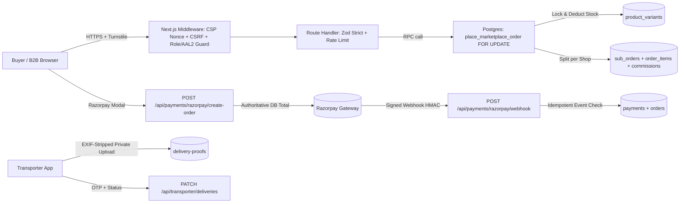

# Trio Dealers — Luxury Multi-Vendor Cloth Marketplace (Retail + B2B Wholesale)

**Trio Dealers** is a full-stack, security-hardened Indian cloth retail & wholesale marketplace built with **Next.js 14 (App Router)**, **TypeScript**, **Tailwind CSS**, **next-intl (`en` / `hi` / `ta`)**, **Supabase (PostgreSQL, Auth, Storage, Realtime, RLS)**, and **Razorpay + COD + NEFT/UPI Proof Settlement**.

All storefront content—products, variants, B2B volume slabs, categories, sub-categories, brands, size charts, banners, flash sales, coupons, CMS pages, bank details, and contact information—is stored dynamically in PostgreSQL and managed via the Admin or Seller workspaces.

---

## 1. Architecture & Folder Tree

```
├── messages/                    # next-intl translations (en.json, hi.json, ta.json)
├── public/                      # Logo (/logo.png), PWA manifest.webmanifest & sw.js
├── scripts/
│   ├── setup-admin.mjs          # Provisions Admin auth user & profile
│   └── backup-export.mjs        # JSON backup exporter via service role
├── supabase/
│   ├── schema.sql               # Base 29-table schema, triggers, storage buckets & RLS
│   ├── migrations/
│   │   └── 20261126000001_complete_marketplace.sql
│   │                            # Phase 1-8 tables, FTS indexes, escalation triggers,
│   │                            # place_marketplace_order atomic RPC, private bucket policies
│   ├── seed-admin.sql           # Admin profile bootstrapper (annuncio8427@gmail.com)
│   └── seed.sql                 # Idempotent dev seed data (mills, textiles, slabs, banners)
├── src/
│   ├── app/
│   │   ├── page.tsx             # SSR/ISR dynamic storefront (banners, flash sales, categories, products)
│   │   ├── catalog/             # Hierarchical category/brand/price/B2B filterable catalog
│   │   ├── product/[slug]/      # PDP w/ slabs, pincode checker, Q&A, alerts, verified reviews
│   │   ├── deals/               # Flash sales, curated bundles & coupons
│   │   ├── compare/             # Up to 4 fabrics side-by-side comparison
│   │   ├── shops/               # Verified partner mills directory (+ /shop/[slug])
│   │   ├── pages/[slug]/        # Dynamic sanitized CMS policy/content pages
│   │   ├── checkout/            # Multi-shop split checkout, wallet, pincode & Razorpay modal
│   │   ├── account/             # Orders, addresses, wallet, loyalty, returns, support, chat, DPDP
│   │   ├── b2b/                 # B2B trade desk, size x color matrix, RFQ, saved lists, team
│   │   ├── seller/              # Seller product CRUD, bulk CSV, packing/GST slip, returns, Q&A, coupons
│   │   ├── transporter/         # Two-leg pickup/delivery OTP handover, reschedule, private proof upload
│   │   ├── admin/               # Executive command, moderation, KYC, finance, homepage, CMS, audit, 2FA
│   │   └── api/                 # Hardened REST handlers (auth, upload, signed-url, search, orders, razorpay)
│   ├── components/              # Navbar, Footer, CartDrawer, ProductCard, B2B Matrix, Addons
│   ├── context/                 # AuthContext (hardened API login/signup/MFA), CartContext (DB merge), Theme
│   └── lib/
│       ├── security/            # CSP headers, CSRF origin check, Upstash/memory rate limit, Turnstile,
│       │                        # AES-256-GCM crypto + masking, EXIF-stripping upload, HTML sanitizer, audit
│       ├── payments/razorpay.ts # Native HTTPS Razorpay REST client & timing-safe HMAC verification
│       ├── email/resend.ts      # Native HTTPS Resend transactional mail helper
│       ├── site-config.ts       # Tag-cached public settings/categories/CMS loader
│       └── dynamic-store.ts     # Tag-cached homepage banners/sections/flash-sales/products loader
└── tests/                       # Vitest security, pricing, governance, webhook & E2E matrix specs
```

---

## 2. End-to-End Data Flow



---

## 3. Supabase Database Setup (Strict Execution Order)

Execute the SQL scripts in the **Supabase Dashboard -> SQL Editor** in this exact order:

1. `supabase/schema.sql` — Creates the core 29 tables, triggers, and initial storage buckets.
2. `supabase/migrations/20261126000001_complete_marketplace.sql` — Adds engagement/CMS/finance/security tables (`b2b_members`, `returns`, `refunds`, `payments`, `flash_sales`, `banners`, `homepage_sections`, `cms_pages`, `audit_logs`, `dpdp_requests`, etc.), FTS indexes, column-escalation triggers, append-only ledger guards, `place_marketplace_order(...)` atomic RPC, and private storage RLS policies.
3. `supabase/seed-admin.sql` — Bootstraps the platform Admin account (`annuncio8427@gmail.com`).
4. *(Optional dev data)* `supabase/seed.sql` — Seeds house mill stock, sample variants, B2B price slabs, hero banner, flash sale, launch coupons, and serviceable pincodes.

---

## 4. Environment Configuration & Deployment (Vercel + Free-Tier Services)

Copy `.env.example` to `.env.local` and configure:

- **Supabase**: `NEXT_PUBLIC_SUPABASE_URL`, `NEXT_PUBLIC_SUPABASE_ANON_KEY`, `SUPABASE_SERVICE_ROLE_KEY`
- **Field Encryption**: `DATA_ENCRYPTION_KEY` (64-char hex or 32+ char secret for AES-256-GCM bank/PAN encryption)
- **Razorpay**: `NEXT_PUBLIC_RAZORPAY_KEY_ID`, `RAZORPAY_KEY_ID`, `RAZORPAY_KEY_SECRET`, `RAZORPAY_WEBHOOK_SECRET` (Webhook endpoint: `https://<your-domain>/api/payments/razorpay/webhook`)
- **Upstash Redis Rate Limiting** *(optional — falls back to in-memory sliding window automatically)*: `UPSTASH_REDIS_REST_URL`, `UPSTASH_REDIS_REST_TOKEN`
- **Cloudflare Turnstile Bot Protection** *(optional in local dev)*: `NEXT_PUBLIC_TURNSTILE_SITE_KEY`, `TURNSTILE_SECRET_KEY`
- **Resend Transactional Email**: `RESEND_API_KEY`, `EMAIL_FROM`

---

## 5. Five-Role Test Guide

1. **Admin (`admin`)**: Sign in at `/login` using the provisioned admin email (`annuncio8427@gmail.com` with your configured password from `.env.local` / `seed-admin.sql`).
   - Enroll TOTP 2FA at `/admin/security` (once verified, AAL2 is required across `/admin/*` mutations).
   - Moderate pending products (`/admin/moderation`), approve Shop KYC (`/admin/shops`) and B2B buyers (`/admin/b2b`), edit banners (`/admin/homepage`), edit CMS & store contact settings (`/admin/cms`), issue flash sales/gift cards (`/admin/marketing`), settle returns (`/admin/returns`), inspect finance ledgers (`/admin/finance`) and security audit logs (`/admin/audit`).
2. **Seller Mill (`shop`)**: Register via `/seller/register`, get approved in `/admin/shops`, then create/edit/duplicate/bulk-CSV import products at `/seller/products`, advance fulfillment & print A4 GST Packing Slips at `/shop-dashboard` -> `/seller/orders/[id]/slip`, answer customer Q&A/chat at `/seller/engagement`.
3. **Wholesale Buyer (`b2b`)**: Register with GSTIN at `/b2b/register`, get verified + assigned credit limit at `/admin/b2b`, place matrix orders on `/b2b/dashboard`, save procurement lists & automate recurring restocks on `/b2b/lists`, invite procurement buyers on `/b2b/team`.
4. **Transporter (`transporter`)**: Provisioned securely by Admin at `/admin/users`. View assigned 2-leg pickups/deliveries on `/transporter`, verify 4-digit OTP handover, upload EXIF-stripped delivery proof into private storage, mark COD cash collection, or reschedule attempts.
5. **Retail Shopper (`user`)**: Register at `/register` (min 10-char complex password), browse dynamic `/`, search `/catalog`, compare on `/compare`, check delivery pincode, redeem coupons/gift cards, pay via Razorpay/COD/Bank proof, file returns, export DPDP data on `/account`.

---

## 6. Security Checklist & Threat Model

| Threat Vector | Implemented Defense |
|---|---|
| Price / Discount / Total Tampering | `POST /api/orders` uses Zod `.strict()` and invokes `place_marketplace_order` RPC; unit prices, B2B slabs, GST, freight, and coupon discounts are computed strictly server-side inside Postgres. |
| Concurrent Oversell / Race Condition | `place_marketplace_order` locks `product_variants` rows with `SELECT ... FOR UPDATE` inside a single DB transaction. |
| Role / KYC Self-Escalation | DB triggers (`guard_profile_escalation`, `guard_shop_kyc_fields`, `guard_b2b_verification_fields`) + column checks block non-admin updates to `role`, `is_active`, `kyc_status`, `commission_rate`, `verification_status`, and `credit_limit`. |
| Razorpay Webhook Spoofing & Replay | Raw-body HMAC-SHA256 verified with `crypto.timingSafeEqual` + unique `webhook_event_id` deduplication in `payments`. |
| Sensitive KYC / Delivery Proof Leaks | `kyc-documents`, `payment-proofs`, `delivery-proofs` are private buckets accessed solely via owner/admin/transporter-authorized 120s signed URLs (`/api/storage/signed-url`). |
| Image XSS / Malicious Upload / EXIF GPS | `/api/upload` & `/api/products/upload` check real binary magic bytes (`JPEG`, `PNG`, `WebP`, `AVIF`, `PDF`), strip JPEG `APP1/APP13/COM` & PNG `eXIf/tEXt/zTXt/iTXt` chunks, and randomize UUID keys. |
| Cross-Site Scripting (XSS) & CSRF | Nonce-based CSP (`applySecurityHeaders`), strict Same-Origin CSRF check (`assertSameOrigin`) on mutating API routes, `sanitizeRichText` tag/attribute allowlist for CMS HTML. |
| Brute Force, Scraping & Account Enum | Upstash Redis + sliding-window memory fallback rate limiting across auth, search, checkout, coupon, Q&A/reviews, uploads; Turnstile verification; uniform non-enumerating auth & reset responses. |
| Sensitive PII Exposure | AES-256-GCM encryption at rest (`encryptSensitiveField`) + masked display (`maskBankAccount`, `maskTaxId`); DPDP export/deletion request logging (`/api/privacy`). |

---

## 7. Verification & Backup Commands

```bash
npm run dev          # Development server
npx tsc --noEmit     # Strict TypeScript check
npm run lint         # Next.js ESLint check
npm test             # Vitest security, pricing, governance & webhook suite
npm run db:backup    # Service-role JSON snapshot backup into ./backups/
```
